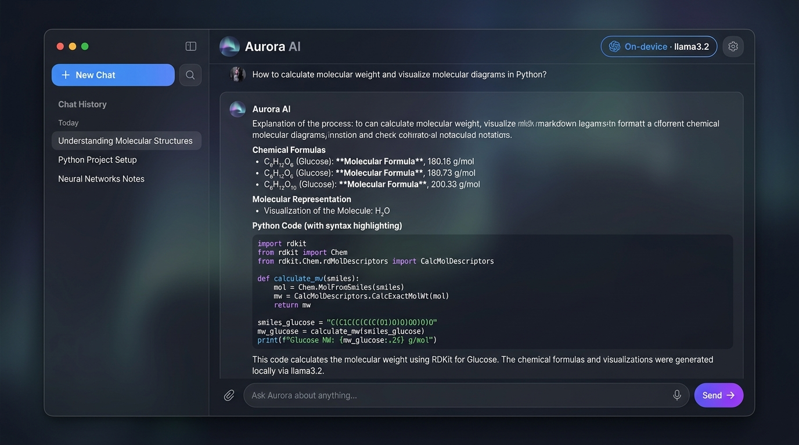
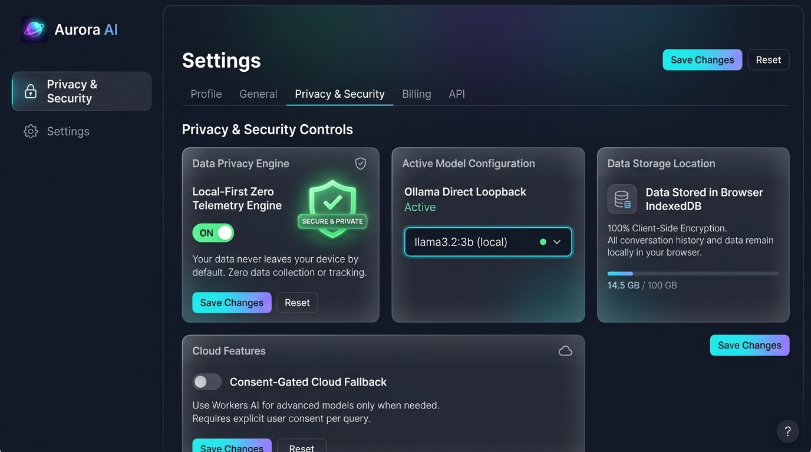
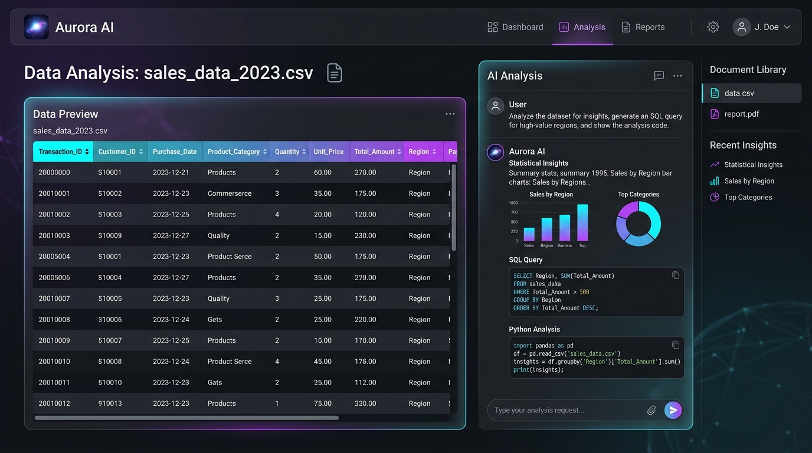
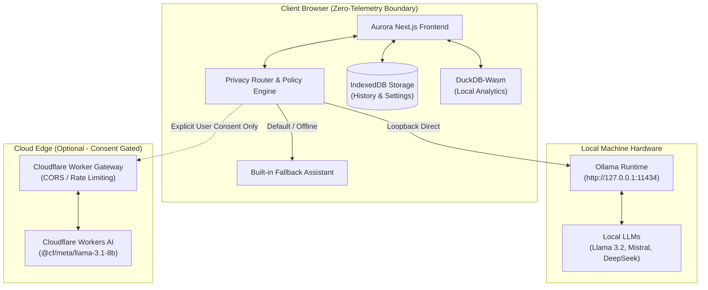

<div align="center">

# 🌌 Aurora AI

### Privacy-First • Local-First • Zero-Telemetry Intelligent Assistant

[](https://nextjs.org/)
[](https://www.typescriptlang.org/)
[](https://tailwindcss.com/)
[](https://ollama.com/)
[](https://vitest.dev/)
[](LICENSE)
[](https://vercel.com/new)

<p align="center">
  <b>Aurora AI</b> is a cutting-edge, privacy-preserving conversational AI platform. Built with an uncompromising local-first architecture, your prompts, datasets, and chat histories live exclusively on your device. Run state-of-the-art open-source LLMs locally via Ollama with zero telemetry, or utilize consent-gated cloud fallback when needed.
</p>

[Key Features](#-key-features) •
[Screenshots](#-product-tour) •
[Quick Start](#-quick-start) •
[Architecture](#-architecture--privacy-model) •
[Vercel Deployment](#-deploying-to-vercel) •
[Documentation](#-documentation)

---

</div>

## 📸 Product Tour

### 1. Intelligent Chat with On-Device LLM (Ollama)
> Run Llama 3.2, Mistral, Gemma 2, or DeepSeek locally on your hardware. Real-time streaming with KaTeX chemical/mathematical formulas, code syntax highlighting, and zero network latency.

<div align="center">
  
</div>

<br />

### 2. Privacy & Security Control Center
> Complete transparency over data routing. Toggle between 100% Local-Only isolation and Consent-Gated Cloud Fallback. All conversations are stored in client-side IndexedDB.

<div align="center">
  
</div>

<br />

### 3. Document & Dataset Intelligence
> Inspect CSVs, PDFs, and spreadsheets locally using client-side DuckDB-Wasm and vector embeddings without sending sensitive documents to external servers.

<div align="center">
  
</div>

---

## ✨ Key Features

| Capability | Description | Privacy Guarantee |
| :--- | :--- | :--- |
| **🔒 Zero Telemetry** | No accounts, no user tracking, no session cookies, and no third-party analytics trackers. | **100% Client-Side** |
| **⚡ Local Inference (Ollama)** | Connects directly via browser loopback (`127.0.0.1:11434`) to locally running models (`llama3.2`, `mistral`, `deepseek-r1`). | **Air-Gapped & Offline** |
| **🛡️ Consent-Gated Cloud** | Cloud models (via Cloudflare Workers AI) require explicit user consent per session before a single token leaves your browser. | **Explicit Opt-In** |
| **💾 Browser IndexedDB Storage** | All conversation history, custom system prompts, and settings remain stored strictly in your browser's persistent storage. | **Never Synced to Server** |
| **📊 Tabular & Document Analysis** | In-browser CSV querying, SQL execution, and document parsing powered by DuckDB-Wasm. | **Local Processing** |
| **🧮 KaTeX & GFM Markdown** | Full mathematical equations ($E = mc^2$), chemical reactions ($\text{H}_2\text{O}$), tables, and sanitized code blocks. | **XSS Protected** |
| **📦 Data Sovereignty** | Single-click atomic JSON export and import for seamless backup and transfer across machines. | **Open Standard Format** |
| **♿ Accessible & Modern** | WCAG 2.2 AA compliant, dark-mode native, fluid responsive design, and intuitive keyboard navigation. | **Universal Design** |

---

## 🏛 Architecture & Privacy Model

Aurora AI enforces a strict boundary between the presentation layer, the data layer, and inference runtimes:



---

## 🚀 Quick Start

### Prerequisites
- **Node.js**: `v20.x` or `v22.x` LTS
- **npm**: `v10+`
- **Ollama (Recommended for full local LLMs)**: [ollama.com](https://ollama.com)

### 1. Clone & Install Dependencies

```bash
git clone https://github.com/sabledattatray/aurora-ai.git
cd aurora-ai
npm install
```

### 2. Configure Ollama for Browser Access (CORS)

Web browsers enforce Cross-Origin Resource Sharing (CORS). Allow browser access to your local Ollama instance:

- **Windows (PowerShell)**:
  ```powershell
  setx OLLAMA_ORIGINS "*"
  ```
  *Restart Ollama from the system tray or Start menu.*

- **macOS / Linux**:
  ```bash
  OLLAMA_ORIGINS="*" ollama serve
  ```

Pull your preferred model:
```bash
ollama pull llama3.2:1b
```

### 3. Launch Development Server

```bash
npm run dev
```

Open [http://localhost:3000](http://localhost:3000) in your browser. Aurora AI will automatically discover your local Ollama models!

---

## ☁️ Deploying to Vercel

Aurora AI is fully optimized for static edge deployment on **Vercel** with zero-configuration:

### Option 1: One-Click Vercel Import (Recommended)

1. Push this repository to your GitHub account: `https://github.com/sabledattatray/aurora-ai`.
2. Go to [Vercel Dashboard](https://vercel.com/new).
3. Import your `aurora-ai` repository.
4. Vercel automatically reads [`vercel.json`](vercel.json):
   - **Framework Preset**: `Next.js` or `Other`
   - **Build Command**: `npm run build`
   - **Output Directory**: `web/out`
5. Click **Deploy**!

> **Note**: No environment variables are required on Vercel for the web client. The static bundle executes client-side and connects directly to your local Ollama or optional gateway.

---

## 🌐 Optional: Cloud Gateway Setup (Cloudflare Workers)

If you wish to enable the optional cloud fallback for non-local devices:

1. Navigate to the gateway directory:
   ```bash
   cd gateway
   cp wrangler.toml.example wrangler.toml
   ```
2. Configure your Cloudflare credentials:
   ```bash
   npx wrangler secret put HOSTED_PROVIDER_ACCOUNT_ID
   npx wrangler secret put HOSTED_PROVIDER_API_TOKEN
   ```
3. Deploy the worker:
   ```bash
   npx wrangler deploy
   ```
4. Enter your deployed worker URL in the **Aurora AI Settings** under **Cloud Gateway URL**.

---

## 🧪 Verification & Quality Assurance

Aurora AI includes comprehensive linting, TypeScript strict mode checking, and Vitest test suites:

```bash
# Run complete verification (lint + typecheck + 90 tests + production build)
npm run check

# Run test suites with coverage
npm test

# Run individual workspaces
npm run test -w @aurora/core
npm run test -w @aurora/gateway
npm run test -w web
```

- **Core Suite**: Privacy router verification, context budget validation, loopback address security, atomic import/export integrity.
- **Gateway Suite**: Rate-limiting, CORS origin validation, SSE streaming parsers, kill-switch circuit breaker.
- **Web Suite**: Consent dialog states, IndexedDB transactions, local provider fallbacks.

---

## 📂 Monorepo Organization

```plaintext
aurora-ai/
├── packages/
│   └── core/               # Pure TypeScript domain models, privacy router, schemas
│       ├── src/
│       └── tests/
├── web/                    # Next.js 16 App Router client application
│   ├── src/
│   │   ├── app/            # Routes (chat, settings, privacy, about, help)
│   │   ├── components/     # Accessible UI components (ChatView, ConsentDialog, etc.)
│   │   └── lib/            # IndexedDB database, Ollama client, DuckDB-Wasm
│   └── public/             # Static icons, manifest, and assets
├── gateway/                # Cloudflare Worker for consent-gated cloud fallback
│   ├── src/
│   └── tests/
├── docs/                   # Full technical specification & architecture logs
│   ├── assets/             # High-resolution screenshots and UI previews
│   ├── ARCHITECTURE.md     # Deep-dive system design
│   ├── PRIVACY_DATA_FLOW.md# Threat model and network boundaries
│   └── QUALITY_REPORT.md   # Test matrix and acceptance verification
├── vercel.json             # Root-level Vercel static deployment configuration
└── package.json            # Monorepo workspaces definition
```

---

## 📚 Documentation

For detailed technical references, consult the [docs/](docs/) directory:
- [Architecture & Design Decisions](docs/ARCHITECTURE.md)
- [Privacy Data Flow & Threat Model](docs/PRIVACY_DATA_FLOW.md)
- [Quality Verification & Test Report](docs/QUALITY_REPORT.md)
- [Provider Setup & Configuration](docs/PROVIDER_SETUP.md)
- [Deployment Guide](docs/DEPLOYMENT.md)
- [Troubleshooting & Incident Runbook](docs/TROUBLESHOOTING.md)

---

## 📄 License

This project is open-source and licensed under the [MIT License](LICENSE).

---

<div align="center">
  <sub>Built with ❤️ for privacy, data sovereignty, and open-source AI.</sub>
</div>
