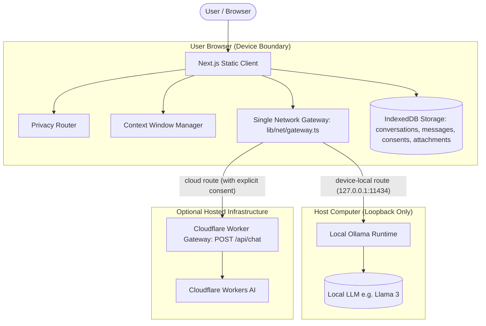

# Architecture Guide

Aurora AI is a privacy-first, local-first artificial intelligence assistant.

## System Diagram

## Component Layers

### 1. Core Abstractions (`packages/core`)
- Pure TypeScript, environment-agnostic library with zero dependencies on browser DOM or Node.js runtime.
- **Privacy Router (`router.ts`)**: Decides whether outbound inference is permitted based on active mode (`local-only` vs `ask-before-cloud`), selected model, and verified unrevoked `ConsentRecord`.
- **Context Manager (`context.ts`)**: Calculates model token budget, reserves output tokens, preserves the system prompt and latest user turn, and truncates older messages with a visible notice (`AC-19`).
- **Loopback Enforcer (`loopback.ts`)**: Enforces strict SSRF protection by ensuring local requests only target loopback interfaces (`127.0.0.1`, `localhost`, `[::1]`).
- **Export/Import Schema (`export-import.ts`)**: Validates `aurora-export` v1 payloads with bounds checking and XSS prevention.
- **Document & File Security (`files.ts`)**: Sniffs file magic bytes (`%PDF-`, `PK\x03\x04`), sanitizes CSV formula injection (`=`, `+`, `-`, `@`), and validates text-to-SQL for in-memory DuckDB queries (single read-only `SELECT`).

### 2. Frontend Client (`web/`)
- Built with **Next.js 16 (App Router)** configured for static HTML/JS export (`output: 'export'`).
- **Storage Layer (`lib/storage/`)**: Local-first persistence in IndexedDB with stores for `conversations`, `messages`, `preferences`, `consents`, `attachments`, and `meta`.
- **Network Discipline (`lib/net/gateway.ts`)**: Single gateway through which all HTTP traffic passes. An ESLint rule (`no-restricted-globals`) bans direct `fetch`/`XMLHttpRequest` everywhere else.
- **Provider Adapters (`lib/providers/`)**:
  - `OllamaProvider`: Connects to `http://127.0.0.1:11434`, reads NDJSON streaming chunks, detects model capabilities, and handles cancellation.
  - `HostedWorkersAIProvider`: Connects to the Cloudflare Worker gateway, consumes Server-Sent Events (SSE), and maps provider errors into safe typed error codes.
- **Safe Markdown Rendering**: Lazy-loaded Markdown pipeline via `react-markdown` + `remark-gfm` + `rehype-sanitize`. Remote image rendering is completely blocked to eliminate image-beacon data exfiltration.

### 3. Hosted Worker Gateway (`gateway/`)
- Lightweight Cloudflare Worker providing a clean, hardened interface for optional hosted models (`@cf/meta/llama-3-8b-instruct`, etc.).
- **Validation**: Strict enforcement of HTTP method (`POST`), Content-Type (`application/json`), payload size (<= 256 KB), origin allowlisting, and `X-Aurora-Consent` headers.
- **Abuse Control**: Rate-limiting keyed by salted SHA-256 hashes of client IPs (zero raw IP addresses stored or logged) and instant kill-switch control.
- **Streaming Translation**: Translates upstream SSE into standard Aurora events (`delta`, `usage`, `done`, `error`).
- **Zero Prompt Retention**: Does not write prompts, completions, or conversation contents to any persistent database or log.
