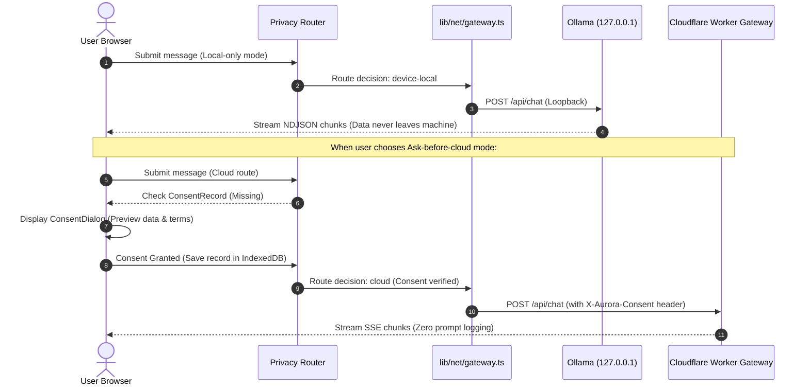

# Privacy Data Flow & Data Retention

This document specifies the exact transmission destinations, data retention policies, and privacy guarantees for every category of data processed by Aurora AI.

## Data Classification & Flow Matrix

| Data Category | Privacy Mode | Transmission Target | Purpose | Retention in Browser | Retention on Remote Server |
|---|---|---|---|---|---|
| **Prompts & Messages** | `Local-only` (Default) | `127.0.0.1:11434` (Ollama loopback) | On-device inference | Stored locally in IndexedDB until deleted | **Zero**. Never sent to any server. |
| **Prompts & Messages** | `Ask-before-cloud` (Requires Consent) | Cloudflare Worker Gateway & Workers AI | Hosted model generation | Stored locally in IndexedDB until deleted | Gateway stores 0 content. Upstream provider terms apply during inference processing. |
| **Document / File Contents** | `Local-only` | Memory / Web Worker only | Local parsing and BM25 search | Stored locally in browser session | **Zero**. |
| **Document / File Contents** | `Ask-before-cloud` | Cloudflare Worker Gateway (Requires separate attachment consent) | Context for Q&A | Stored locally in browser | Transmitted only if explicitly granted; no storage on gateway. |
| **Conversation Titles** | All modes | Local device only | Sidebar navigation | Stored locally in IndexedDB | Derived deterministically from first user prompt. No model or network calls. |
| **Preferences & Settings** | All modes | Local device only | Theme, model selection, privacy mode | Stored locally in IndexedDB | **Zero**. |
| **Client IP Address** | `Ask-before-cloud` (Gateway requests) | Cloudflare Edge Network | Ephemeral rate-limiting | None | Hashed with salt (`SHA-256`); raw IP is **never logged or persisted**. |
| **Analytics & Telemetry** | All modes | **None** | N/A | None | **Zero analytics or third-party trackers are included in MVP.** |

---

## Architectural Data Flow Diagram

---

## Right to Deletion & Data Portability
- **Delete Conversation**: Permanently removes the conversation and all associated messages from browser IndexedDB.
- **Delete All Data**: Clears conversations, messages, consent records, and preferences in an atomic database transaction.
- **Export All Data**: Exports all conversations and messages as a portable `aurora-export` JSON file that can be inspected, backed up, or imported into another browser.
